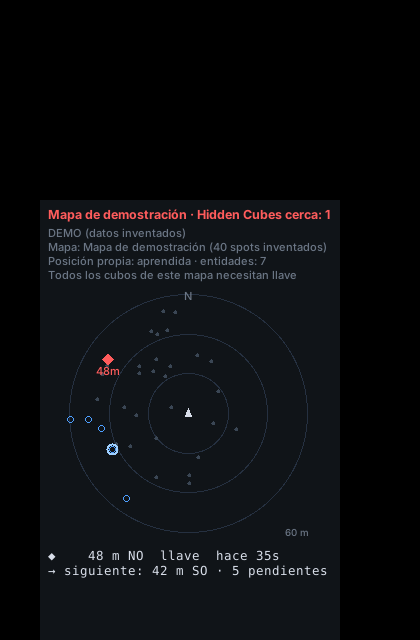

# Aion2 Helper: radar de Hidden Cubes

Overlay **de uso personal** para AION 2 que avisa (con sonido y un radar) cuando aparece un
**Hidden Cube** cerca de tu personaje, y te dice a cuántos metros y en qué dirección está. Además te
guía por los 3 722 spots posibles de los cubos (los rojos que piden llave y los dorados gratuitos) y
tacha los que ya has revisado.



> ⚠️ Usar herramientas de terceros puede ir contra los términos de servicio de AION 2. El proyecto
> no tiene relación con NCSOFT. Úsalo bajo tu responsabilidad.

## Cómo funciona

Los cubos rotan entre miles de spots posibles: 1 440 en Verteron, 1 371 en Altgard, 456 en Eltnen y
455 en Morheim. Un mapa estático no te dice dónde está el cubo *ahora*. El servidor, en cambio, solo
envía al cliente las entidades que tienes cerca. Cuando un cubo entra en tu radio de visión, el servidor
manda su registro de "spawn", y la herramienta lo lee.

Los spots se descargan de [aion2.th.gl](https://aion2.th.gl/guides/Hidden%20Cube), que los extrae de
los ficheros del juego en las mismas coordenadas que envía el servidor. Con ellos la herramienta:

- **sabe en qué mapa estás**, porque las entidades que te rodean caen sobre los puntos fijos de ese mapa;
- **aprende sola el código del cubo**: el código cuyas entidades aparecen justo encima de spots
  conocidos. Ya no hace falta calibrar;
- te muestra los **spots pendientes** cercanos, tacha los que ya revisaste y te indica el siguiente;
- distingue los cubos **con llave** (rojos; todos en Verteron y Altgard) de los **gratuitos** y muestra
  la regla del mapa.

La investigación completa sobre las webs de la comunidad y su formato de datos está en
[docs/INVESTIGACION_CUBOS.md](docs/INVESTIGACION_CUBOS.md).

Usa la misma técnica que los DPS meters open source del juego
([A2Tools](https://github.com/taengu/A2Tools-DPS-Meter),
[domel1998/Aion2DPSMeter](https://github.com/domel1998/Aion2DPSMeter),
[NOIA2](https://github.com/ZDYoung0519/NOIA2),
[cyberbadger6969/aion2-dps-meter](https://github.com/cyberbadger6969/aion2-dps-meter)):

- **Captura pasiva** del tráfico con Npcap. No envía nada al juego ni a sus servidores, no lee ni
  escribe la memoria del juego y no inyecta nada en él.
- El flujo del juego no va cifrado: paquetes con longitud varint y bundles comprimidos con LZ4.
- `41 36 <id> <mask> … <código NPC u24> 00 (00|40) 02 <x f32> <y f32> <z f32>`: spawn de NPC/objeto
  con su posición en el mundo, en unidades de Unreal (cm).
- `42 36 <id> 00 <flag>`: muerte (flag 3) o desaparición (flag 7). Con eso el cubo se quita del radar.
- `23 36 00`: cambio de zona. Se vacía todo.

Tu **posición propia** no está documentada en ningún proyecto, así que la herramienta la **aprende
sola**: busca en los paquetes que tu cliente envía al servidor el campo con tres floats que se mueven
de forma continua y que siempre quedan cerca de las entidades que el servidor te va spawneando. Cuando
lo encuentra lo guarda en la configuración. Hasta entonces el aviso de "cubo cerca" funciona igual,
pero sin distancia ni flecha.

## Instalación (Windows 10/11)

1. Instala **Npcap** desde <https://npcap.com/#download> y marca *"Install Npcap in WinPcap
   API-compatible Mode"*.
2. Instala Python 3.10 o superior (marca "Add to PATH").
3. En esta carpeta:
   ```
   pip install -r requirements.txt
   ```
4. Ejecuta **como administrador** (Npcap y los atajos globales lo necesitan):
   ```
   python -m aion2_helper
   ```
5. Pon el juego en **pantalla completa sin bordes** o en ventana: en pantalla completa exclusiva
   Windows no deja dibujar nada encima.

Para ver el overlay sin el juego: `python -m aion2_helper --demo --discovery`.

La primera vez que arranca descarga los spots de aion2.th.gl (unos 400 KB) y los renueva cada 7 días.
Si no hay conexión, ejecuta más tarde `python -m aion2_helper update-spots`.

## Calibración: automática

No hay que hacer nada: juega normalmente. En cuanto veas un cubo, la herramienta lo reconoce porque está
sobre un spot conocido, avisa y, con el segundo, guarda su código en `cube_codes`. El overlay muestra
"Código del Hidden Cube aprendido solo". En Verteron y Altgard el código queda marcado como cubo con
llave.

Si quieres hacerlo a mano (por ejemplo, sin los spots descargados):

**Forma rápida:**
1. Arranca en modo descubrimiento: `python -m aion2_helper --discovery --log`
2. Busca un cubo como siempre (baja la música y los efectos: el cubo emite un zumbido brillante).
3. Ponte **al lado** del cubo y pulsa **F9**. Se añade a `cube_codes` el código de la entidad más
   cercana (a menos de 8 m). Si aún no hay posición propia, se usa la entidad que apareció más
   recientemente; en ese caso es mejor usar la forma de abajo.

**Forma robusta** (si F9 elige mal):
1. Juega con `--log` y pulsa **F8** cada vez que estés junto a un cubo (con 3 o 4 basta).
2. Analiza el registro:
   ```
   python -m aion2_helper analyze "%APPDATA%\Aion2Helper\logs\discovery-XXXX.jsonl"
   ```
3. Copia el código con mejor puntuación en `cube_codes` de `%APPDATA%\Aion2Helper\config.json`.

Pueden existir varios códigos (cubo con llave, cubo gratuito y versión submarina). Con los spots
descargados, `analyze` los ordena solo, sin marcas F8. Para colorear un código como gratuito, pon
`"cube_kinds": {"1234567": "free"}` en la configuración.

## Atajos (configurables en `config.json`)

| Tecla | Acción |
|---|---|
| F6 | Vuelve a poner todos los spots como pendientes (por ejemplo, al cambiar de canal) |
| F7 | Modo descubrimiento: muestra las entidades cercanas con su código |
| F8 | Marca "aquí hay un cubo" en el registro (para `analyze`) |
| F9 | La entidad más cercana es un cubo: guarda su código |
| F10 | Click-through on/off (el ratón atraviesa el overlay) |
| F11 | Mostrar/ocultar overlay |

Arrastra el overlay con el ratón para moverlo; con **clic derecho** se cierra.

## Spots

En el radar:

| Símbolo | Significado |
|---|---|
| ◆ rojo | Hidden Cube que necesita llave |
| ◆ dorado | Hidden Cube gratuito (`cube_kinds`) |
| ◆ naranja | Hidden Cube de tipo desconocido |
| ○ azul | Spot por revisar |
| · gris | Spot revisado: pasaste cerca y estaba vacío. Vuelve a azul a los 30 min (`spot_recheck_s`) |
| ◎ azul claro / flecha | Siguiente spot pendiente más cercano |

Un spot cuenta como revisado cuando pasas a menos de 40 m (`spot_check_radius_m`). La herramienta ajusta
ese radio sola según la distancia a la que te van apareciendo los cubos.

`python -m aion2_helper update-spots` descarga los spots al momento. Si la descarga falla (proxy,
firewall...), baja a mano los ficheros `World_*.raw` de `https://cdn.th.gl/aion2/nodes/` (los nombres
actuales aparecen como `nodesPaths` en el código fuente de <https://aion2.th.gl/maps/Verteron>) y usa
`update-spots --from carpeta`.

Además, cada cubo detectado se guarda en `%APPDATA%\Aion2Helper\spots.json`. Esos spots propios se
muestran mientras no se reconoce el mapa. `python -m aion2_helper import-spots fichero.csv` añade spots
en **coordenadas del mundo** (`x,y,z`).

## Opciones

```
python -m aion2_helper [--discovery] [--log [ruta]] [--record juego.pcap] [--iface NOMBRE|all]
python -m aion2_helper replay juego.pcap [--fast] [--headless]
python -m aion2_helper analyze registro.jsonl
python -m aion2_helper update-spots [--from carpeta]
python -m aion2_helper import-spots spots.csv
python -m aion2_helper ifaces
```

- `--record` guarda el tráfico del juego para reproducirlo después con `replay`. El .pcap contiene
  nombres de personajes, así que no lo compartas.
- `--iface all` si usas VPN o un reductor de ping y no se detecta la conexión.

## Si deja de funcionar tras un parche

Los parches a veces renumeran opcodes: el de junio de 2026 movió la familia `xx 36` en +1. Todo está
en `config.json`:

```json
"opcodes": { "spawn": ["41 36"], "despawn": ["42 36"], "zone_change": ["23 36"],
             "signatures": ["0E 00 36", "06 00 36"] }
```

Mira qué cambian los DPS meters citados arriba y copia sus valores. Si la posición propia se aprende
mal, borra `"self_position"` (déjalo en `null`) para que se vuelva a aprender.

Si el mapa no se reconoce nunca ("buscando mapa"), borra `"world_transform"` (déjalo en `null`) y
ejecuta `update-spots`.

Otros ajustes: `radar_range_m`, `radar_rotation_deg` y `radar_mirror` (si el norte del radar no
coincide con el del mapa), `cube_ttl_s`, `sound`, `overlay.alpha`, `auto_cube_codes` (desactiva el
aprendizaje automático), `community.auto_update` y `community.max_age_days`.

## Desarrollo

```
pip install -e .[dev]
pytest
```

| Ruta | Qué hace |
|---|---|
| `aion2_helper/protocol.py` | Framing (varint, LZ4), spawn/despawn/zona |
| `aion2_helper/capture.py` | Npcap/scapy, reensamblado TCP, detección de la conexión, pcap |
| `aion2_helper/selfpos.py` | Aprendizaje de la posición propia |
| `aion2_helper/detector.py` | Estado del mundo y cubos activos |
| `aion2_helper/overlay.py` | Overlay tkinter y atajos globales |
| `aion2_helper/analyze.py` | Ranking de códigos a partir de las marcas F8 |
| `aion2_helper/spots.py` | Spots vistos por ti |
| `aion2_helper/community.py` | Descarga y conversión de los spots de aion2.th.gl |
| `aion2_helper/cborx.py` | Decodificador CBOR con las extensiones de cbor-x (formato de th.gl) |
| `aion2_helper/worldmap.py` | Índice de spots, detección de mapa, aprendizaje del código, spots revisados |

Los tests usan bytes reales de una captura del 6 de octubre de 2026 publicados en los tests de A2Tools.
